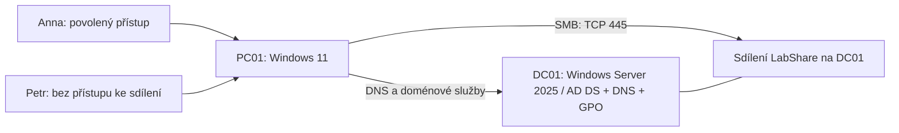

# Windows Support Lab — správa malé firemní sítě

Praktický projekt Windows Serveru a Windows 11: sestavení malé domény, správa uživatelů a přístupů, nastavení pracovní stanice, síťová diagnostika a řešení servisních požadavků. Prostředí představuje malou kancelář se zaměstnanci Annou a Petrem.

Projekt vzniká s pomocí Codexu. Dosavadní sestavení a ověřovací běhy provedl Codex; samostatné opakování autorem čeká. Výsledky popisují skutečný laboratorní stav, nikoli profesní praxi.

## Prostředí

VirtualBox Internal Network `windows-support-isolated`, síť `10.10.10.0/24`. DC01 má `10.10.10.10`, PC01 `10.10.10.20`; klient používá DNS server DC01. Doména `lab.example.test`. Adresy jsou zatím statické, bez DHCP, routeru a výchozí brány. [Úplná topologie](docs/architecture.md).

## Co lze v projektu ověřit

Stav k 14. 10. 2026. „Ověřeno“ znamená skutečnou kontrolu v labu; „připraveno“ znamená popsanou další úlohu.

| Oblast | Konkrétní práce | Stav a důkaz |
|---|---|---|
| Virtualizace a Windows | Server 2025, Windows 11, síť, párový snapshot | [Ověřený základ](evidence/baseline.md) |
| IP, DNS a porty | statické adresy, A/SRV záznamy, nalezení DC, TCP 445 | [Ověřeno; DNS incident](incidents/INC-001-dns.md) |
| Active Directory | doména, připojení PC, OU, účty a vnořené skupiny | [Ověřeno](evidence/baseline.json) |
| SMB a NTFS | čtení/zápis Anně, zamítnutí Petrovi | [Ověřeno; oprava přístupu](incidents/INC-002-share.md) |
| Group Policy | uživatelská GPO, kontrola výsledku a chování | [Ověřeno i na ploše](evidence/baseline.md) |
| PowerShell | diagnostické skripty a strukturovaná kontrola stavu | [Skript](scripts/Test-LabHealth.ps1), [výsledky](evidence/health-checks.md) |
| Servisní práce | stav před poruchou → diagnóza → oprava → opakovaný test | [Dva provedené případy](docs/project.md#servisní-případy) |
| Nástup a odchod zaměstnance | vytvoření účtu, přidělení a odebrání přístupu | [Připravený postup](operations/employee-lifecycle.md) |
| DHCP | automatické adresy, scope, lease a rezervace | [Další etapa](docs/project.md#další-etapy) |
| Záloha, obnova a údržba | obnova souboru, události a audit aktualizací | [Další etapy](docs/project.md#další-etapy) |

## Jak projekt projít

1. [Scénář kanceláře a pracovní úkoly](docs/project.md) — co spravuji a podle čeho poznám výsledek.
2. [Pojmy na konkrétních příkladech](docs/concepts.md) — IP, DNS, DHCP, doména, OU, skupiny, GPO, SMB a NTFS.
3. [Instalace](docs/01-installation.md) a [funkční základ](docs/02-baseline.md) — sestavení prostředí.
4. [Provozní kontrola](operations/daily-check.md) — příkazy a čtení výsledků.
5. [Servisní případy](docs/project.md#servisní-případy) — diagnostika a opravy.

Každá praktická úloha končí konkrétním nastavením, testem pod správným účtem, vysvětlením a vybraným důkazem. [Přehled důkazů](docs/verification.md).

## Rozsah a omezení

DC01 má 2 vCPU / 2 GB RAM, PC01 2 vCPU / 4 GB RAM. Kvůli prostředkům hostitele je sdílení na řadiči domény; produkční návrh by role oddělil. Windows jsou Evaluation. Windows 11 na použitém procesoru je nepodporovaný experiment. Audit aktuálních oprav, DHCP a obnova záloh zatím nejsou dokončené. Snapshot `baseline-01` uchovává původní funkční základ na obou VM; není náhradou zálohy.

Do repozitáře patří dokumentace, vlastní skripty a vybrané důkazy. Hesla, instalační obrazy, virtuální disky a původní diagnostické výpisy jsou soukromé. [Zdroje a inspirace](docs/sources.md), [publikace](docs/publication.md).
