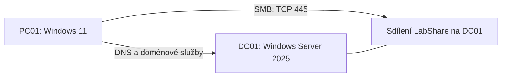

# Windows Server a sítě

Dva virtuální počítače propojené do domény: Windows Server a pracovní stanice s Windows 11. Projekt slouží k praktickému zkoušení sítí, správy účtů, sdílení souborů, oprávnění a nastavení Windows. Dokumentace zachycuje zapojení, použité příkazy a výsledky jednotlivých pokusů.

## Zapojení

Oba stroje běží ve VirtualBoxu ve společné vnitřní síti, oddělené od domácí LAN. Server má adresu `10.10.10.10`, klient `10.10.10.20`, oba s maskou `/24`. Doména se jmenuje `lab.example.test`. Adresy jsou nastavené ručně; DHCP ani router zatím nejsou součástí labu. [Podrobné zapojení](docs/architecture.md).

## Co už funguje

- **Doména a DNS:** PC01 je připojený do domény a přes DNS najde její řadič.
- **Účty a skupiny:** dva běžné účty mají rozdílný přístup ke stejnému sdílení. Anna může dokumenty číst a měnit, Petr přístup nemá.
- **Sdílení a oprávnění:** přístup k LabShare určují skupiny v Active Directory a oprávnění SMB i NTFS.
- **Skupinové zásady:** GPO omezuje přístup do Ovládacích panelů; ověřené je nastavení i skutečné chování ve Windows.
- **PowerShell:** kontrolní skript ověřuje síť, DNS, doménu a služby. Na serveru prošlo 13 kontrol, na klientovi 8. [Výsledky](evidence/health-checks.md).

## Pokusy s konfigurací

Při změně DNS klient přestal nacházet doménové služby. Při odebrání přístupové skupiny zůstával server dostupný, ale čtení souboru bylo odmítnuté. Oba pokusy mají zaznamenaný stav před změnou, diagnózu a ověření po opravě.

| Pokus | Stav |
|---|---|
| [Nesprávný DNS server](incidents/INC-001-dns.md) | provedeno a vráceno do funkčního stavu |
| [Odebrání přístupu ke složce](incidents/INC-002-share.md) | provedeno a vráceno do funkčního stavu |
| [Zakázaný účet](incidents/INC-003-account.md) | připravený postup |
| [Neaplikovaná GPO](incidents/INC-004-gpo.md) | připravený postup |
| [Zapomenuté heslo a zamčený účet](incidents/INC-005-password.md) | připravený postup |
| [Posunutý čas](incidents/INC-006-time.md) | připravený postup |

## Další rozšíření

DHCP a přidělování adres, zachycení síťové komunikace, mapování disku přes GPO a záloha s obnovou souboru. Později může přibýt menší aplikace pro zkoušení funkčních testů, API a SQL.

## Dokumentace a skripty

- [Přehled hotových částí a dalších pokusů](docs/project.md)
- [Vysvětlení pojmů na tomto zapojení](docs/concepts.md)
- [Instalace](docs/01-installation.md) a [nastavení domény](docs/02-baseline.md)
- [Kontrola stavu](operations/daily-check.md) a [práce s účty](operations/employee-lifecycle.md)
- [Diagnostický skript](scripts/Test-LabHealth.ps1), [ověření základu](evidence/baseline.md) a [technické zdroje](docs/sources.md)

Server používá 2 vCPU a 2 GB RAM, klient 2 vCPU a 4 GB RAM. Vytvářecí skript nastavuje oběma VM 4 GB; paměť serveru byla po vytvoření snížena. Soubory jsou kvůli velikosti labu přímo na doménovém řadiči. Snapshot `baseline-01` na obou strojích uchovává výchozí funkční stav. Hesla, instalační obrazy a virtuální disky nejsou v repozitáři.
