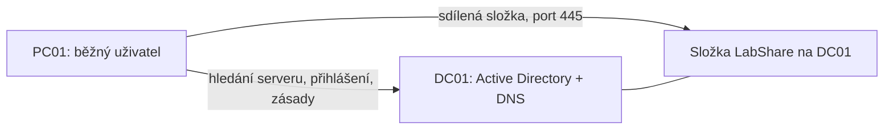

# Zapojení labu

## Síť

Oba počítače mají jednu síťovou kartu ve vlastní vnitřní síti VirtualBoxu (`windows-support-isolated`). Do domácí sítě ani na internet z ní nevede cesta; změny se provádějí uvnitř labu. Adresy jsou nastavené ručně, v síti není DHCP ani router.

| Počítač | Adresa | DNS server | Brána |
|---|---|---|---|
| DC01 | 10.10.10.10 / 24 | vlastní DNS, aktuálně 127.0.0.1 | žádná |
| PC01 | 10.10.10.20 / 24 | 10.10.10.10 | žádná |

Doména se jmenuje `lab.example.test`, krátce `LAB`.

**Proč PC01 používá jako DNS právě server DC01:** DNS tu neslouží jen k překladu webových adres. Počítač se přes něj ptá, kde v síti běží server pro přihlašování. Veřejné DNS servery tuhle zkušební doménu neznají, takže s jiným nastavením by počítač doménu nenašel.

Pro aktivaci a aktualizace se karta vypnutého počítače dočasně přepne na internet (NAT) a potom se vrátí zpět. Druhá trvalá karta na serveru se nepřidává, protože by se server v DNS zaregistroval pod dvěma adresami.

## Uživatelé a skupiny

Složky v Active Directory: `Lab`, pod ní `Users`, `Groups` a `Workstations`.

| Účet | Role |
|---|---|
| `anna.lab` | běžná uživatelka s přístupem ke sdílené složce |
| `petr.lab` | běžný uživatel bez přístupu |
| správce labu | samostatný účet jen pro správu |

Běžní uživatelé nejsou správci domény.

Práva ke složce se nedávají přímo lidem, ale skupinám:

`anna.lab` → skupina `GG_LabStaff` (kdo to je) → skupina `DL_LabShare_Modify` (co smí) → oprávnění ke složce.

Výhoda: když přijde nový kolega, stačí ho přidat do první skupiny a oprávnění složky se nemusí měnit.

## Sdílená složka

`\\DC01\LabShare`, na serveru `C:\LabShare`. Přístup hlídají dvě vrstvy a platí ta přísnější:

- oprávnění sdílení: skupina `DL_LabShare_Modify` má Change,
- oprávnění na disku (NTFS): stejná skupina má Modify.

Správci mají plný přístup. V malém labu je složka přímo na serveru domény; ve firmě by byla na samostatném souborovém serveru.

## Firemní zásada

Zásada `LAB-User-ControlPanel` zakazuje uživatelům Ovládací panely a Nastavení (User Configuration → Administrative Templates → Control Panel → Prohibit access to Control Panel and PC settings). Je připojená k OU `Lab/Users` (organizační jednotce, nikoli výchozímu kontejneru `Users`). Výchozí zásada domény se pro tohle cvičení nemění.

Na DC01 znamená DNS 127.0.0.1 jeho vlastní službu. Na PC01 by stejná adresa ukazovala na klienta, který DNS neposkytuje; klient proto používá 10.10.10.10. [Provozní kontrola](../evidence/health-checks.md) rozlišuje obě role a ověřuje skutečné A/SRV odpovědi.
