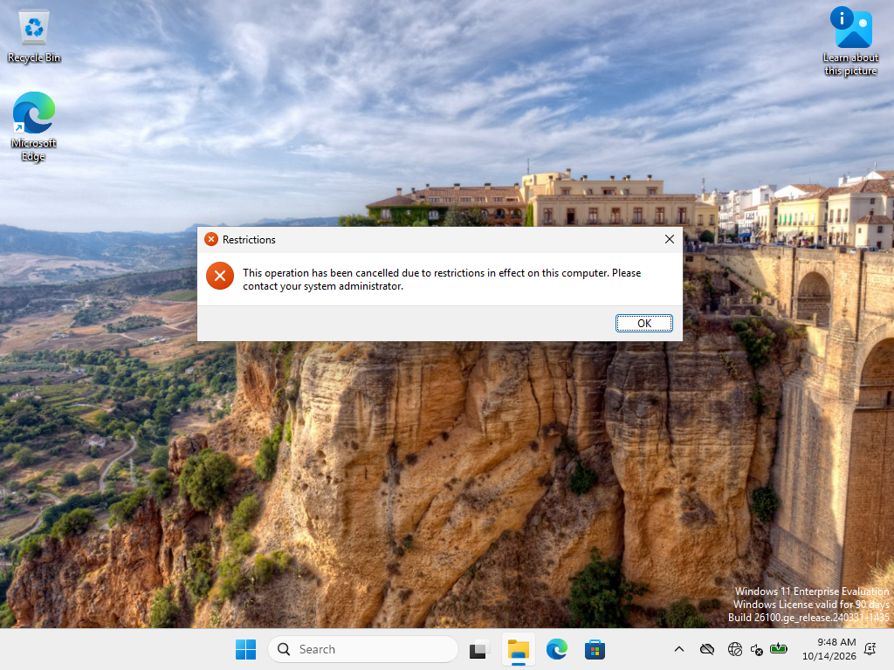

# Ověření funkčního základu, 14. října 2026

| Kontrola | Výsledek |
|---|---|
| Systémy | Aktivovaný Windows Server 2025 Standard Evaluation a Windows 11 Enterprise Evaluation |
| Síť | Internal Network, PC01 DNS 10.10.10.10, bez výchozí IPv4 brány |
| Doména | PC01 je členem lab.example.test, Test-ComputerSecureChannel=True |
| DNS a SMB | LDAP SRV vrací DC01:389; TCP port 445 dostupný |
| Anna | Čtení welcome.txt, vytvoření a smazání vlastního souboru prošlo |
| Petr | Přístup k welcome.txt odepřen |
| Přihlášení | Interaktivní relace LAB\anna.lab na PC01 |
| Skupinová zásada | LAB-User-ControlPanel použitá; NoControlPanel=1; otevření Ovládacích panelů blokované |
| DNS incident | Chybný DNS vyvolal timeout; po vrácení DNS nalezení řadiče a secure channel opět prošly |
| Návratový bod | Snapshot baseline-01 na obou vypnutých VM |

[Vybrané výsledky v JSON](baseline.json), [stav serveru](server-verification.md), [instalace klienta](client-installation.md).

Při návratu k výchozímu stavu se obnovují odpovídající snapshoty obou vypnutých VM. Následuje kontrola času, DNS a zabezpečeného spojení s doménou.
